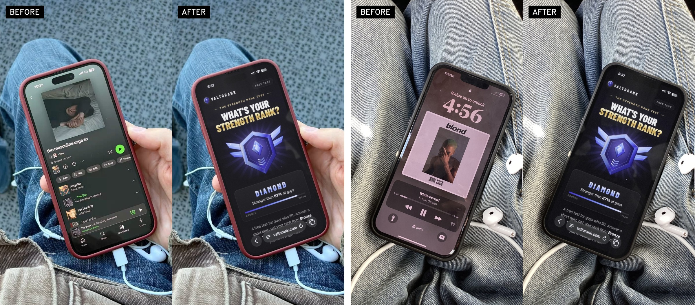
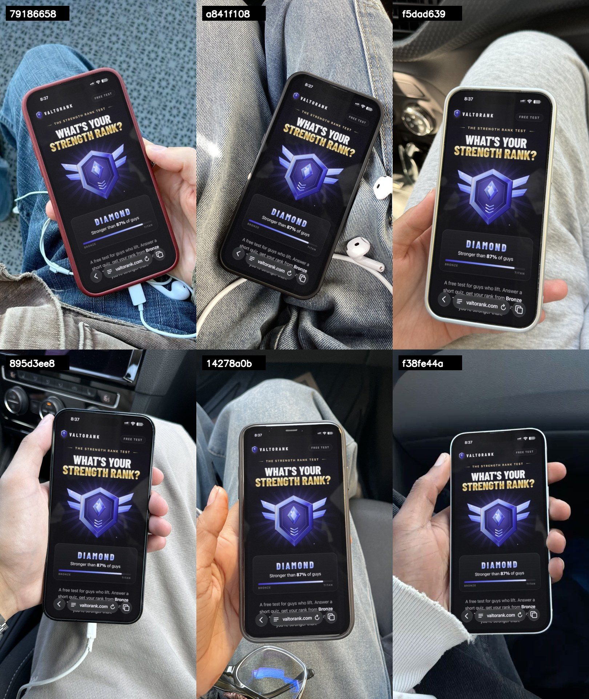

# phone-screen-swap

Put any image on the screen of a real phone photo, and have it look like the photo was taken that way.



This isn't an AI edit and it isn't a flat mockup. Code finds the phone's real edges in the photo, then redraws the whole front: the screen, the black frame, and the notch or island, with the photo's perspective, lens bend, light and noise. Outside the glass, the photo stays untouched.

## Quick start

Six templates are ready. You need Python 3.

```bash
git clone https://github.com/onemanylov/phone-screen-swap && cd phone-screen-swap
```

```bash
pip install -r requirements.txt
```

```bash
python3 swap.py assets/example-screen.png --statusbar
```

You get six photos in `out/example-screen/` in about 15 seconds. Now use your own image:

```bash
python3 swap.py my-image.png
```

## The templates



| Template | Phone | Scene |
|---|---|---|
| `79186658` | island, red case | on denim |
| `a841f108` | notch, dark case | on denim |
| `f5dad639` | island, light case | in hand, in a car |
| `895d3ee8` | island, no case | in hand, in a car |
| `14278a0b` | notch, clear case | in hand, in a car |
| `f38fe44a` | notch, white frame | in hand, sleeve in the shot |

## Swapping images

```bash
python3 swap.py my-image.png -t a841f108,79186658
```

```bash
python3 swap.py my-screenshot.png --statusbar
```

- **Shape:** the screen is 591×1280. Any other shape is scaled and centre-cropped, never stretched.
- **`--statusbar`:** for a real iPhone screenshot. Its time and icons move to where each phone shows them, so they don't land under a notch. It expects them where an iPhone with an island puts them (see `assets/example-screen.png`).
- **Top of your image:** the notch or island is drawn over it, so keep important things out of that spot.

## New photos from Pinterest

```bash
python3 find_photos.py search "taking photo of sneakers with iphone" --limit 60
```

```bash
python3 find_photos.py related https://www.pinterest.com/pin/1234567890/ --limit 60
```

Each run saves the photos to `photos/` with a numbered contact sheet. Pinterest's "more like this" on a photo you liked finds real snapshots best. No login needed.

To turn a photo into a template, open this folder in [Claude Code](https://claude.com/claude-code) and run the skill:

```
/phone-screen photos/some-folder/photo.jpg
```

It follows [the steps in the skill](.claude/skills/phone-screen/SKILL.md), which you can also run by hand. A new phone takes a few minutes. It uses no image generator or API key.

Skip photos with a finger or sleeve over the screen: that case isn't handled on new photos, and it would get painted over. Tilted phones are refused.

## How you know it fits

- **Red test:** the same build on a solid red screen shows the shape, the cutout, and any gap.
- **Proof:** the fit leaves out part of the edge, then gets scored on what it didn't see.
- **Leak map:** a thermal map of everything from the old screen that still shows through the glass.
- **White test:** a bright image shows up the corners and edges that a dark page hides.

## Limits

- Only iPhones are modelled.
- Tested on the six templates and one new photo, with dark, white and colour images.
- macOS is the only system it has been run on.

## Rights

The code is MIT. The photos in `templates/` and `docs/` came from Pinterest and belong to their authors: they aren't covered by the license, and we don't hold rights to them. They are here to try the tool. Check you may use a photo before you publish anything made from it. The page in the example screen is [ValtoRank](https://valtorank.com), shown as a sample.
